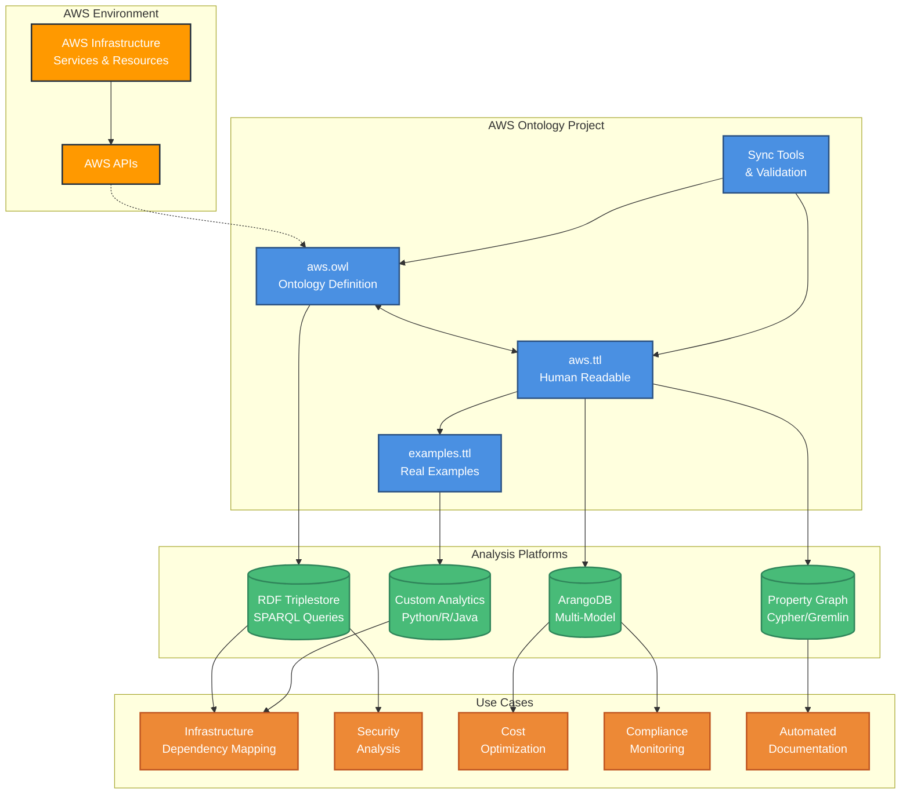

# AWS Ontology

[](https://github.com/arango-solutions-org/aws-ontology/actions/workflows/ci.yml)
[](LICENSE)

A comprehensive semantic ontology for Amazon Web Services (AWS) resources and their relationships. This project provides a formal OWL ontology that models AWS infrastructure, services, and their complex interdependencies for advanced analysis, compliance monitoring, and automation. The AWS ontology can be used to bootstrap AWS graph projects for infrastructure mapping, security analysis, and cost optimization on graph databases that can ingest ontologies.  These include RDF databases that work natively with ontologies and property graph databases with RDF adapters, for example, it can be used with the [ArangoDB semantic layer integration](docs/ARANGODB_INTEGRATION.md) to generate ArangoDB graph schemas in different graph models such as Labeled Property Graphs (LPG) LPG, Property Graphs (PG) , and W3C Semantic Graphs (RDF).   

## Overview

The AWS Ontology is a semantic web resource that:

- **Models 163 AWS resource classes** across compute, storage, networking, containers, API services, generative AI, workforce and consumer identity, governance, detective security, DNS, caching, analytics, and deployment
- **Defines 159 object properties and 123 datatype properties**, including temporal, cost, and compliance relationships
- **Ships 207 example instances** with sanitized, realistic AWS configurations
- **Is published in two synchronized serializations** (Turtle and RDF/XML), verified triple-for-triple identical
- **Includes semantic constraints** (cardinality restrictions, disjoint categories, inverse and sub-properties) and SHACL shapes for closed-world validation of instance data
- **Is verified in CI** by the HermiT OWL 2 DL reasoner (ontology + examples are consistent), SHACL validation, and a test suite

## Current Metrics

| Metric | Count |
|--------|-------|
| **Total Triples** | 2,220 |
| **Classes** | 163 |
| **Object Properties** | 159 |
| **Datatype Properties** | 123 |
| **Example Instances** | 207 |

## Namespace and Versioning

| | IRI |
|---|---|
| Ontology | `https://w3id.org/arango-solutions/aws-ontology` |
| Term namespace | `https://w3id.org/arango-solutions/aws-ontology#` (prefix `aws:`) |
| This version | `https://w3id.org/arango-solutions/aws-ontology/0.6.0` |
| Examples | `https://w3id.org/arango-solutions/aws-ontology/examples` |

Releases follow [Semantic Versioning](https://semver.org/); `owl:versionInfo` matches the latest
[CHANGELOG](CHANGELOG.md) release. Versions before 0.6.0 used the provisional namespace
`http://www.semanticweb.org/aws-ontology#` — see the CHANGELOG for migration notes.

## Quick Example

Get started in 30 seconds - here's how to query AWS resources using SPARQL:

```sparql
# Find all resources and their encryption status
PREFIX aws: <https://w3id.org/arango-solutions/aws-ontology#>
PREFIX rdfs: <http://www.w3.org/2000/01/rdf-schema#>

SELECT ?resource ?label ?encrypted WHERE {
  ?resource aws:encrypted ?encrypted .
  ?resource rdfs:label ?label .
}
```

```python
# Python example using rdflib
from rdflib import Graph, Namespace

g = Graph()
g.parse("ontology/aws.ttl", format="turtle")
g.parse("ontology/examples.ttl", format="turtle")

# Execute SPARQL query
results = g.query("""
    PREFIX aws: <https://w3id.org/arango-solutions/aws-ontology#>
    SELECT ?service ?depends_on WHERE {
        ?service aws:dependsOn ?depends_on .
    }
""")

for row in results:
    print(f"{row.service} depends on {row.depends_on}")
```

```javascript
// AQL example after importing ontology + examples with tools/import_to_arangodb.py
// (ArangoRDF PGT: one collection per RDF class, one edge collection per object property)
FOR instance IN EC2Instance
    FOR vpc IN 1..1 OUTBOUND instance belongsToVPC
        RETURN {
            instance: instance._label,
            arn: instance.arn,
            vpc: vpc._label
        }
```

**What you get:** Immediate insight into your AWS infrastructure relationships, security posture, dependencies, and cost optimization opportunities through semantic queries across multiple database platforms.

## Ontology Structure

### Visual Overview

*AWS Ontology class hierarchy and relationships as viewed in Protégé*

### Architecture Overview

*How the AWS Ontology integrates into analysis workflows across different platforms and use cases*

### Core Service Categories
- **Deployment & CI/CD**: CloudFormation (Stacks, StackSets, Change Sets), CodePipeline (Pipelines, Stages)
- **Analytics**: Glue (Databases, Tables, Crawlers, Jobs), Athena (WorkGroups, Data Catalogs, Query Executions), Kinesis (Streams, Firehose, Analytics Applications), EMR (Clusters, Steps, Notebooks), OpenSearch (Domains, Indexes)
- **AI/Generative AI**: Bedrock Foundation Models, Agents, Knowledge Bases, Guardrails; SageMaker Notebooks, Training Jobs, Models, Endpoints
- **Workforce Identity**: IAM Identity Center Instances, Permission Sets, Account Assignments
- **Consumer Identity**: Cognito User/Identity Pools, Identity Providers (SAML/OIDC/social), IAM SAML/OIDC Providers
- **Governance**: Organizations, Organizational Units, Control Tower Landing Zones
- **Detective Security**: GuardDuty Detectors & Findings, Security Hub & Standards Subscriptions
- **Container Services**: ECS, EKS, Fargate, ECR
- **API & Integration**: API Gateway, Step Functions, EventBridge, SNS, SQS
- **Compute**: EC2, Lambda, Auto Scaling Groups
- **Storage**: S3, EBS, EFS, RDS Clusters & Snapshots
- **Database**: DynamoDB, DocumentDB, Redshift, RDS, ElastiCache
- **Networking**: VPC, Security Groups, Load Balancers, Elastic IPs, NAT/Internet Gateways, VPC Endpoints, Route 53, Transit Gateway, Direct Connect (Gateways, Connections, Virtual Interfaces)
- **Identity & Access**: IAM Users, Roles, Policies, Instance Profiles
- **Security**: KMS Keys & Aliases, Secrets Manager, Network ACLs, Security Group Rules, WAF (Web ACLs, Rule Groups, IP Sets)
- **Content Delivery**: CloudFront Distributions
- **Monitoring**: CloudWatch, CloudTrail, Systems Manager, AWS Config (Rules, Configuration Recorder, Conformance Packs)

### Advanced Relationship Types
- **⏰ Temporal**: `createdBefore`, `replacedBy`, `migratedFrom`
- **Cost**: `incursChargeFor`, `optimizedBy`, `allocatesCostTo`
- **Compliance**: `compliesWith`, `auditedBy`, `controlledBy`

## Why Use the AWS Ontology?

The AWS Ontology provides a structured, semantic foundation for understanding and analyzing AWS infrastructure relationships. Here's why it's valuable:

### **Project Development Benefits**
The structured semantic relationships in the ontology support various AWS infrastructure analysis projects:

- **Infrastructure Dependency Mapping**: Visualize and analyze complex resource relationships across your AWS environment
- **Impact Analysis**: Understand cascading effects of changes before implementation
- **Security Policy Validation**: Ensure compliance and identify security gaps through relationship analysis
- **Cost Optimization**: Discover resource relationships that drive costs and optimization opportunities
- **Multi-Account Governance**: Track and manage resources across organizational boundaries
- **Automated Documentation**: Generate up-to-date architecture diagrams and dependency maps
- **Resource Discovery**: Find orphaned resources and understand their connections

### **Graph Database Integration**
The ontology can be imported into graph databases for enhanced querying and analysis capabilities. For example, the ArangoDB integration using ArangoRDF supports multiple physical graph models:
- **Labeled Property Graphs (LPG)**: Industry-standard format for maximum compatibility
- **ArangoDB-native Property Graphs**: Optimized for performance and native capabilities
- **RDF Graph Schemas**: Maintain semantic web standards while leveraging multi-model features

This approach allows you to choose the most appropriate representation for your specific analysis requirements.

## Quick Start

### Prerequisites
- Python 3.11+
- RDF processing tools (rdflib)
- Optional: Protégé for visual exploration
- Optional: ArangoDB for graph database integration

### Installation

```bash
# Clone the repository
git clone https://github.com/arango-solutions-org/aws-ontology.git
cd aws-ontology

# Option A (recommended): uv — creates .venv from the lockfile
uv sync

# Option B: classic venv + pip
python3 -m venv venv
source venv/bin/activate
pip install -r requirements.txt pytest ruff

# Verify ontology integrity
python tools/sync_formats.py check

# Run the test suite
python -m pytest
```

## Repository Structure

```
aws-ontology/
├── ontology/
│   ├── aws.ttl           # Main ontology, Turtle (the editing source)
│   ├── aws.owl           # Main ontology, RDF/XML (generated from aws.ttl)
│   ├── aws.shapes.ttl    # SHACL shapes for instance-data validation
│   ├── examples.ttl      # Sanitized example instances
│   └── catalog-v001.xml  # Maps ontology IRIs to local files (Protégé)
├── docs/
│   ├── PRD.md           # Product Requirements Document
│   ├── PROTEGE_GUIDE.md # Protégé exploration guide
│   ├── SPARQL_EXAMPLES.md # 22 ready-to-use SPARQL queries
│   └── USAGE_GUIDE.md   # Comprehensive usage documentation
├── tests/               # Comprehensive test suite
├── tools/               # Format synchronization utilities
└── automation/         # AWS change monitoring tools
```

## Protégé Integration

Open the ontology in Protégé for visual exploration:

```bash
# Method 1: Direct open
open ontology/aws.owl

# Method 2: Manual open in Protégé
# File → Open → ontology/aws.owl
```

**Key Protégé Features:**
- **Class Hierarchy**: Browse 163 AWS resource classes
- **Object Properties**: Explore 159 relationship types
- **Reasoning**: Validate with HermiT reasoner
- **OntoGraf**: Visualize relationships graphically
- **SPARQL**: Test queries from our examples

See [`docs/PROTEGE_GUIDE.md`](docs/PROTEGE_GUIDE.md) for detailed exploration instructions.

## SPARQL Querying

The ontology supports rich SPARQL queries for analysis:

```sparql
# Find all container services
PREFIX : <https://w3id.org/arango-solutions/aws-ontology#>
SELECT ?service ?label WHERE {
  ?service rdfs:subClassOf* :ComputeResource .
  ?service rdfs:label ?label .
  FILTER(CONTAINS(?label, "ECS") || CONTAINS(?label, "EKS"))
}

# Find services that can trigger Step Functions
SELECT ?service ?stepFunction WHERE {
  ?service :triggersStepFunction ?stepFunction
}
```

See [`docs/SPARQL_EXAMPLES.md`](docs/SPARQL_EXAMPLES.md) for 22 ready-to-use queries.

## Tools & Utilities

### Format Synchronization
```bash
# Check OWL ↔ TTL synchronization
python tools/sync_formats.py check

# Convert OWL to TTL
python tools/sync_formats.py owl-to-ttl

# Convert TTL to OWL
python tools/sync_formats.py ttl-to-owl
```

### Quality Assurance
```bash
# Run all quality tests
make test

# Test specific aspects
python -m pytest tests/test_ontology_quality.py -v
python -m pytest tests/test_examples_validation.py -v
python -m pytest tests/test_format_sync.py -v

# Lint and format
make lint
make format
```

### AWS Change Monitoring
```bash
# Monitor AWS service changes
python tools/monitor_aws_changes.py

# Schedule automated monitoring
make schedule-setup
```

## Use Cases

### 1. Infrastructure Analysis
- Model complex AWS architectures
- Analyze service dependencies
- Identify optimization opportunities

### 2. Compliance Monitoring
- Track compliance status across resources
- Audit relationships and governance
- Monitor policy adherence

### 3. Cost Optimization
- Analyze cost allocation relationships
- Identify shared resources
- Model optimization scenarios

### 4. Security Analysis
- Map IAM relationships and permissions
- Analyze access patterns
- Identify security risks

### 5. Migration Planning
- Model current and target states
- Track migration relationships
- Plan temporal sequences

## Testing Framework

Comprehensive testing ensures ontology quality:

- **Format Synchronization**: OWL ↔ TTL consistency
- **Ontology Quality**: Class/property validation
- **Example Validation**: Instance integrity
- **Performance**: Loading and query benchmarks
- **DL Compliance**: OWL 2 DL profile checks (undeclared terms, illegal axioms)
- **Consistency**: HermiT reasoner over ontology + examples, plus a fast disjointness-clash check
- **Tool Smoke Tests**: every CLI must start up and answer `--help`

All of the above run in GitHub Actions CI on every push and pull request.

```bash
# Run all tests
make test

# Test categories
make test-sync     # Format synchronization
make test-quality  # Ontology structure
make test-examples # Example validation
make test-performance # Performance benchmarks
make test-dl       # OWL 2 DL compliance
make test-smoke    # CLI smoke tests
```

## Development Workflow

### Adding New Services
1. Define classes and properties in `ontology/aws.ttl` (the editing source)
2. Regenerate the OWL serialization: `python tools/sync_formats.py ttl-to-owl`
3. Create examples in `ontology/examples.ttl`
4. Verify sync: `python tools/sync_formats.py check`
5. Run tests: `make test`
6. Update documentation

### Contributing
See [CONTRIBUTING.md](CONTRIBUTING.md). Security issues: see [SECURITY.md](SECURITY.md).

## Integration

### Graph Database Integration
The ontology supports multiple graph database representations:
- **RDF Triplestores**: Direct loading as RDF/OWL with full semantic reasoning support
- **ArangoDB**: Multi-model database integration using ArangoRDF for graph analytics and AQL queries
- **Labeled Property Graphs (LPG)**: Transform to property graph format with labeled nodes and edges for modern graph databases
- **Property Graphs (PG)**: Convert to property graph structures optimized for performance and graph analytics
- **Custom Transformations**: Flexible transformation patterns for domain-specific use cases and requirements

#### ArangoDB Integration
```bash
# Import AWS ontology into ArangoDB
python tools/import_to_arangodb.py

# Query with AQL
from arango import ArangoClient
client = ArangoClient(hosts='http://localhost:8529')
db = client.db('aws_ontology', username='root', password=os.getenv('ARANGO_PASSWORD', 'your_password'))
```

### Analysis Tools
- **Python**: rdflib, owlready2, networkx
- **Java**: Apache Jena, RDF4J, OWL API, JGraphT
- **JavaScript**: rdflib.js, cytoscape.js
- **R**: rdflib for R, igraph
- **SPARQL**: Standard RDF query language support

## Documentation

- [Usage Guide](docs/USAGE_GUIDE.md) - Comprehensive usage instructions
- [SPARQL Examples](docs/SPARQL_EXAMPLES.md) - Query examples and patterns
- [ArangoDB Integration](docs/ARANGODB_INTEGRATION.md) - Graph database setup and usage
- [Environment Variables](docs/ENVIRONMENT_VARIABLES.md) - Configuration and deployment settings
- [Protégé Guide](docs/PROTEGE_GUIDE.md) - Visual ontology exploration
- [Maintenance Strategy](docs/MAINTENANCE_STRATEGY.md) - Long-term maintenance approach

## Community

### Questions & Support
- Create GitHub issues for questions
- Check existing documentation first
- Provide minimal reproduction examples

### Feature Requests
- Submit detailed GitHub issues
- Explain use case and benefits
- Consider contributing implementation

## License

This project is licensed under the MIT License - see the [LICENSE](LICENSE) file for details.

## Citation

If you use the AWS Ontology in research, please cite it using the metadata in
[CITATION.cff](CITATION.cff).

## Version History

See [CHANGELOG.md](CHANGELOG.md) for detailed version history.

---

**Disclaimer**: This is an independent, community-maintained ontology published by Arango. It is
not affiliated with, endorsed by, or sponsored by Amazon Web Services. AWS and the AWS service
names used here are trademarks of Amazon.com, Inc. or its affiliates. The ontology is authored
from publicly available AWS documentation only.
